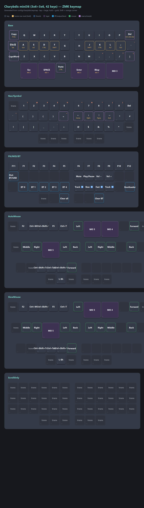

# 키맵



- `keymap-layers.png` — Base / Nav·Symbol / FN·MID·BT / AutoMouse / SlowMouse / ScrollOnly 전체
- `keymap-layers.html` — 같은 내용의 브라우저용 ( 확대·축소 가능 )
- `keymap.old.html` — 교체 전 손으로 그려 펌웨어와 어긋나 있던 옛 그림(아카이브)
- `keymap-layers.json` — 위 그림의 원 데이터(키별 tap/hold/shift/아이콘/설명/레이어)

그림은 `config/charybdis.keymap` 을 **파싱해서** 생성했습니다. 손으로 그린 키맵
그림은 펌웨어와 어긋나도 티가 나지 않지만 이 생성기는 컴파일되는 파일에서 바로
읽습니다.

## 읽는 법

| 위치 | 의미 |
| --- | --- |
| 가운데 큰 글자 | 탭(짧게 누르기) |
| 아래 금색 글자 | 홀드(길게 누르기) — home-row mod, 레이어 전환 |
| 오른쪽 위 주황 | Shift 조합 결과 |
| 아이콘 아래 작은 글자 | 기능 설명 (마우스 클릭·미디어·BT·특수 키) |
| 위쪽 작은 회색 글자 | 마우스 레이어 단축키 조합 (C=Ctrl, S=Shift) |
| 왼쪽 위 작은 숫자 | matrix 인덱스 (0–35 본문, 36–38 왼 엄지, 39–41 오른 엄지) |

레이어 전환 키는 `MO n` 대신 레이어 이름(Nav/Sym, FN/BT, AutoMouse, SlowMouse, Scroll)을
표시합니다. 마우스 클릭은 세 칸 버튼 아이콘(■¦□¦□ 등)으로 어느 버튼인지 보여줍니다.

테두리 색: 금색 = home-row hold-tap, 남색 = 엄지, 보라 = 레이어 전환, 초록 = 마우스,
파랑 = BT/출력/부트로더, 자주 = 매크로·mod-morph·미디어.

## 다시 생성하기

```bash
python3 ../tools/keymap_diagram.py ../config/charybdis.keymap keymap-layers.html keymap-layers.json
```

PNG이 필요하면 `keymap-layers.html` 을 브라우저(Edge/Chrome)에서 열고 전체 페이지를
캡처하면 됩니다. headless Edge를 써도 됩니다:

```bash
msedge.exe --headless=new --disable-gpu --hide-scrollbars --force-device-scale-factor=2 \
  --window-size=940,2500 --virtual-time-budget=8000 \
  --screenshot="keymap-layers.png" "file:///절대경로/keymap-layers.html"
```

Python 표준 라이브러리만 사용합니다(별도 패키지 불필요).

## 참고: 옛 그림(`keymap.old.html`)과 달라던 부분

교체 전에 있던 손으로 그린 그림은 다음이 실제 펌웨어와 달랐습니다.

- Base 오른 엄지 마지막 키: `MO 5` → 실제로는 `&mo 3` (AutoMouse)
- Base ENTER 홀드: `L2` → 실제로는 `&lt 3 RET`
- `p_slash` mod-morph: 탭 `\` / Shift `|` 로 뒤집혀 있었음 → 실제로는 탭 `|`, Shift `\`
- SlowMouse·ScrollOnly 레이어 누락 (4/6만)
- 엄지 matrix 인덱스를 42–44로 표기 → 실제로는 39–41
